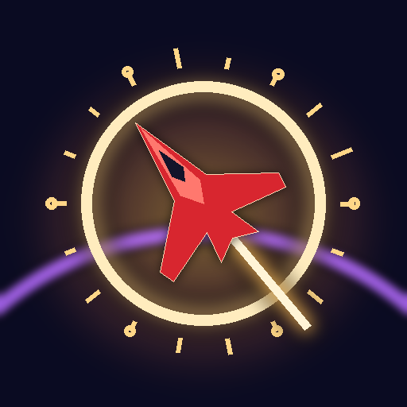

# Ultrablast Turbo (Android)



The mobile edition of Ultrablast Turbo: a landscape arcade flyer built with three.js and wrapped as an
Android app with Capacitor. Fly around a tiny glass planet, chain crystals and gold gates, and stay inside
the circle while the storm closes in over six stages, Fortnite style.

## How it plays

| | |
|---|---|
| **Steer** | Drag anywhere on the left half. Up/down climbs or dives; let go and the ship levels out, circling the planet. Near the planet or a moon you skim the surface. |
| **Boost** | Hold **BOOST** to charge up to 3 rings, let go to blast through them. While boosting you smash drones and jets. Short cooldown, no heat. |
| **ULTRA** | Crystals, gates, takedowns and tunnel exits fill the gold ring around BOOST. When it is full, tap **ULTRA**: the ship chains through up to 8 targets. Tap as each ring closes for PERFECT. It never fails. |
| **Storm** | The safe circle waits, then shrinks to the white ring. Outside it you lose a shield every few seconds. Survive the final circle to win. |
| **Shields** | 3 shields. Hits, drones and the storm take one each; with none left the next hit ends the run. Blue hexagon pickups give one back. |
| **Combo** | Every pickup, gate and takedown within 3 s builds the combo; every 5 adds ×0.5 to your multiplier (up to ×5). |

The first run teaches itself: steer, boost, gates, crystals, then the storm starts. Each run has three
star goals: survive the storm, reach a ×3 combo, land a perfect ULTRA.

What changed from the desktop prototype: one boost button instead of charge + boom + turbo cells; no heat or
vent; no miniblast puzzles (ULTRA's timing taps replace them); the core's phase/defense states, orb rails and
weapon pickups are gone; the hex barrier became the storm.

## Get the APK (no Android tools needed)

Every push to `main` runs **Actions → Android build** on GitHub. Open the latest run and download the
`ultrablast-turbo-debug-apk` artifact, unzip it, copy the `.apk` to your phone and open it (allow
"install unknown apps" for your file manager or browser when Android asks).

To publish a GitHub release with the APK attached: `git tag v1.0.0 && git push --tags`.

## Build it yourself

You need Node 22+, JDK 21 and the Android SDK (Android Studio installs it; set `ANDROID_HOME`).

```bash
npm ci
npm run apk          # builds the game, syncs it into android/, runs ./gradlew assembleDebug
adb install -r android/app/build/outputs/apk/debug/app-debug.apk
```

Or open the `android/` folder in Android Studio after `npm run sync` and press Run.

Try it in a browser without Android: `npm run serve`, then open the printed address (a phone on the same Wi-Fi
works too; turn it sideways).

### Signed release builds (Play Store)

Create a keystore once:

```bash
keytool -genkeypair -v -keystore release.keystore -alias ultrablast -keyalg RSA -keysize 2048 -validity 10000
base64 -w0 release.keystore   # macOS: base64 -i release.keystore
```

Add these repository secrets (Settings → Secrets and variables → Actions): `ANDROID_KEYSTORE_BASE64` (the
base64 text), `ANDROID_KEYSTORE_PASSWORD`, `ANDROID_KEY_ALIAS`, `ANDROID_KEY_PASSWORD`. The workflow then also
produces a signed `ultrablast-turbo-release.apk` and an `.aab` for the Play Console. Keep the keystore safe:
you need the same one for every update.

## Project layout

```
src/                 game source, concatenated in name order into www/js/game.js (npm run build)
  00_core.js         renderer, quality tiers, touch / keyboard / gamepad input, haptics
  05_audio.js        WebAudio: samples, live jet engine, storm drone, music with slow-mo
  10_world.js        planet, moons, storm zone, tunnels, crystals, gates, shield pickups
  20_ship.js         jet model, flight model (gravity skim + orbit assist), camera
  30_fx.js           particles, shockwaves, glass-shatter event text, screen doodles, storm arrows
  40_enemies.js      drones, jets, projectiles
  50_play.js         boost, ULTRA, combo, shields, pickups, storm rules, enemy director
  60_ui.js           HUD, radar, coach / onboarding, screens, settings
  90_main.js         game flow, main loop, Android back button and app lifecycle
www/                 the web app Capacitor ships (index.html, css, assets; js/ and vendor/ are generated)
android/             the Capacitor Android project (landscape, full screen, keeps the screen awake)
scripts/             build.mjs, vendor.mjs (offline three.js + fonts), serve.mjs, make-icons.py
```

Tuning lives near the top of the relevant file: `STORM_PHASES` and `STORM_TICK` (10_world.js / 50_play.js),
`BLAST_LEVEL_T` and the boost numbers in `releaseCharge` (50_play.js), `MAX_DRONES` / `MAX_JETS` per circle
(50_play.js), meter gains in the `award(...)` calls.

Graphics are AUTO by default: full effects at up to 1.5× pixel ratio, dropping to BATTERY SAVER (no bloom, 1×)
if a phone holds under 40 fps for a few seconds. Settings lets players pin either.

## Credits

See [CREDITS.md](CREDITS.md).
